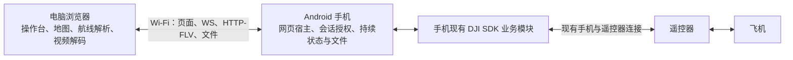

# 手机提供网页与设备服务的架构提案

日期：2026-10-04。状态：待审阅的设计提案；未实施，未做手机宿主或浏览器真机验证。

本提案针对用户确认的现场条件：电脑和 Android 手机连接同一个 Wi-Fi／路由器，手机继续连接 DJI 遥控器。目标是电脑日常使用时只打开浏览器，手机 APK 承担网页发布、设备服务和持续运行。电脑不需要 Electron、Node、`server.exe` 或本机媒体服务器，也不需要云服务承载控制和图传。

用户进一步明确日常操作目标：手机只打开 App，自动启动所需服务；其他业务操作都在电脑网页完成。首次安装时的 Android 权限／USB 授权及首次电脑身份登记单独处理，不要求每次点击手机启动按钮或重复批准已授权电脑。

连接入口进一步按“手机广播服务信息、电脑用密码授权、不要求记住 IP”设计：优先验证稳定本地域名的 mDNS 解析；多手机的服务枚举由入口手机执行，再通过网页接口展示。普通浏览器不直接接收 UDP 广播。

这是一项跨端架构迁移，不是把 `electron/main.mjs` 上传后直接访问。网页构建产物可以放入 APK，由手机发送给浏览器；Node/Electron 宿主能力要重新分配。原桌面方案在迁移期间保留，用于实测对照和回退。本提案不改变两端当前生产契约。

## 1. 建议与方案比较

建议采用“手机发布同源网页 + WebSocket 控制 + HTTP 文件传输”，首版图传优先验证 H.264 → HTTP-FLV，沿用网页中的 `mpegts.js`。WebRTC 是后续媒体替换选项，不是已有代码打开开关就能完成的能力。

| 方案 | 控制和网页 | 图传 | 适用性与代价 |
| --- | --- | --- | --- |
| A：手机发布整套网页，首版 HTTP-FLV | 电脑访问手机，同一地址提供页面、状态、文件和 WS | 手机直接封装 DJI H.264，浏览器沿用现有播放器 | 推荐；减少跨域配置，最接近现有播放器行为；仍需新做 Android FLV 封装和媒体宿主 |
| B：手机发布整套网页，图传 WebRTC | 与 A 相同 | 手机 PeerConnection 直接发送，浏览器接收 | 有更低延迟和网络适应的潜力；需新增浏览器直连信令、编码适配、重连与统计，现有 WHIP 代码只能部分复用 |
| C：外部网站发布网页，手机只提供设备接口 | 网页服务器与手机不同源 | 网页另连手机本地媒体接口 | 便于独立更新网页，但需要额外解决跨域、HTTPS 页面访问 HTTP/WS、本地网络权限与发现；不适合本次简化现场接入的首版目标 |

三种方案都不能免除手机 APK 持续运行。A/B 的网页、控制和图传可在无互联网的可互通局域网内工作；现有在线底图、DJI 注册等外部依赖要另行确认，不能据此宣称整套系统已完全离线。

## 2. 目标结构与责任



HTTP-FLV 是独立 HTTP 流，不经过命令 WS。图传与照片传输在网络和执行队列上都应与控制消息分开。手机提供网页文件并不等于手机绘制地图；Cesium、三维模型和网页视频解码仍由电脑 CPU/GPU 完成。

| 功能／事实 | 目标所有者 | 复用与调整 |
| --- | --- | --- |
| 操作台、地图、三维模型、航线预览和规划 | 浏览器 | 复用渲染器、地图与纯 TS 逻辑；替换 Electron 桥接、文件选择和资源地址 |
| KML/KMZ 解析、预览与可执行资格计算 | 浏览器 | 尽量复用 importer/qualification；重计算可放 Worker，浏览器资格判断不能替代手机执行前检查 |
| 正式航线库、已暂存任务文件 | 手机文件存储 | 新增多文件航线目录；继续复用现有暂存大小、摘要和原子替换规则 |
| 手机、遥控器、飞机实际连接状态与遥测 | 手机 DJI 模块 | 浏览器只展示带身份、版本与时效的快照，不自行推测飞机状态 |
| 航线上传、执行、阶段事实与操作结果 | 手机持续运行时 | 保留 `missionRevision`、`deviceGeneration`、真实 DJI 阶段事件；新增刷新后的恢复读取 |
| 飞行动作、相机和图传设置、拍照 | 手机现有业务处理器 | 网页请求经过授权和现有协调模块；不能让新 HTTP 入口直接绕过处理器调用 DJI |
| 操作界面二次确认 | 浏览器；手机验证权限和状态 | 清空过期确认，确认绑定设备和当前状态；电脑侧判断不能成为唯一控制门禁 |
| 视频封装、媒体连接与队列 | 手机媒体模块 | A 为 H.264 HTTP-FLV；浏览器继续解码。避免默认在手机解码再编码 |
| 原图与诊断日志的持久副本 | 手机 | 浏览器显示目录、预览和下载；不能把网页内存中的接收成功当成 Windows 文件落盘 |
| 当前页面、视角、临时编辑内容 | 浏览器 | 小量本地缓存可用 IndexedDB；正式航线、任务与原图不依赖某个手机 IP 对应的浏览器存储 |

第一条验证链路可以只连接一台手机，但最终迁移完成仍须满足当前项目的多手机／多飞机要求。所有设备状态始终按 `deviceId` 分离；任务设备选择与图传设备选择保持独立。

## 3. 电脑怎样连接手机

正常使用流程：

1. 手机连接遥控器，电脑和手机接入同一个可互通的 Wi-Fi／路由器。
2. 打开手机 APK。App 自动创建或复用持续运行时，启动网页／WS 宿主并初始化 SDK。实际端口绑定成功后显示“服务已启动”、当前 Wi-Fi 地址和设备就绪状态，不要求手动点击启动。
3. 电脑 Chrome／Edge 打开收藏的手机本地域名。例如 `http://skycommand-a1b2c3.local:8088/`，单手机现场可额外提供 `http://skycommand.local:8088/` 别名。由系统解析到手机当前 Wi-Fi IP；这些是拟定示例，不是当前程序已有入口，须先通过目标电脑／网络的 mDNS 验证。
4. 首次登记这台电脑时，在电脑网页输入手机自动显示的短时配对码，手机验证后保存授权并签发凭证，无需另点手机确认。以后凭证有效且未被撤销时自动验证、建立 WS、读取恢复快照，满足设备条件后启用操作。
5. 电脑网页完成图传开始／停止、航线、飞控、相机、拍照、原图和日志操作。手机主界面仅展示地址、连接与故障状态；授权撤销、服务诊断保留在非日常使用的管理入口。刷新网页自动重连和读取状态，不自动重发飞行动作。

### 3.1 自动启动与首次设置

“只打开 App”是完成初始设置后的正常流程，自动化按以下规则实现：

- 从用户打开的 Activity 发起前台运行时启动；重复打开 App 或 Activity 重建时复用同一运行时，不能重复监听端口、注册 SDK 或创建采样器。用户没有打开 App 时，首版不承诺开机自启。
- 网页宿主启动与 DJI 就绪分开。即使遥控器未接入、SDK 初始化尚未完成或需要权限，已登记电脑仍可连接网页并看到具体等待状态。只有依赖该条件的业务操作被禁用，不能让“SDK 未就绪”变成“网页无法打开”。
- 自动启动限于网页、会话、SDK 和状态采集等准备工作，不自动起飞、对频、开始航线或恢复旧飞行动作。图传开始、任务启动和对应确认由电脑网页触发。
- 首次安装时的系统运行权限、USB 设备访问／默认打开选择，以及设备确实需要的系统设置，必须通过 Android 界面完成。网页可显示缺少哪项条件，但不能代替 Android 授权或绕过系统弹窗。用户撤销权限、换设备或系统再次要求授权时也可能需要处理。
- 身份信任记录由手机持久保存，电脑保存可验证凭证；信任与 `bootId`／单次控制连接分离。手机重新打开后，已有凭证可自动验证，新控制会话仍须取得当前控制权并读取最新设备状态。初始凭证有效期设为 30 天，撤销、过期、清除浏览器数据或重装 App 后重新登记；认证不能只依据 IP、Wi-Fi 名称或客户端自报 ID。
- 一次性配对码按默认 2 分钟有效、成功后立即失效，并限制失败尝试。输入该码本身构成首次登记授权，不增加第二次手机确认；配对码不成为长期控制凭证。重复启动 App 不循环重置防猜测计数，受控局域网 HTTP 的传输限制仍适用。
- 优先使用每部手机稳定的本地域名，经目标电脑／路由器验证后收藏入口。IP 改变但域名与端口不变时，网页 origin 保持一致，电脑可继续使用原授权。若局域网禁用 mDNS，则使用路由器本地 DNS／DHCP 地址保留；最后保留手机显示 IP 的故障回退入口。直接改用 IP 会产生不同 origin，可能需要重新登记。

手机页面不承担日常业务配置。电脑断开后的重新连接由网页客户端负责；手机网络恢复后自动恢复监听与只读状态，不自动恢复已失效的控制确认或飞行动作。电脑端“结束使用”可停止观看／图传并释放控制权，手机宿主保留待命；必须停止的真实任务仍由明确的任务操作控制。

### 3.2 广播发现与密码连接

用户希望的广播用于发布“手机在哪里”，授权仍通过连接后的网页接口完成。mDNS 使用局域网组播查询／响应，DNS-SD 描述服务实例、主机与端口；不广播密码、控制令牌或任务信息。

首版目标流程为：App 自动监听成功 → 发布服务及稳定主机名 → 电脑打开已知 `.local` 名称 → 操作系统解析当前 IP → 浏览器请求网页 → 首次输入配对密码并保存授权。电脑不需要另装发现程序；但它必须具备可用的系统 mDNS 解析，并与手机处于可互通的网络。用户需要知道一次入口名称或收藏入口，不等同于打开任意网站就能枚举所有手机。

实现约束：

- 设备首次安装生成持久短 ID，规范主机名为 `skycommand-<shortId>.local`；服务实例可显示友好设备名称。单手机可提供 `skycommand.local` 别名，多手机时该别名只归明确指定的入口手机，避免指向随意变化的设备。
- Android `NsdManager` 可用于 DNS-SD 服务注册／发现，建议服务类型 `_skycommand._tcp.`，SRV 中提供实际绑定端口。仅设置 serviceName 并不保证电脑能解析同名 `.local` 主机；稳定 URL 还需要正确的主机 A／AAAA 记录和 mDNS responder 实现。这两部分都属于宿主原型验收，不能只看到注册回调成功就宣布网址可用。
- 只发布当前 Wi-Fi 上实际监听成功的服务。网络变化时撤销旧发布、更新地址记录，按所选 Android 网络实现正确管理组播资源；App 停止后清理发布。名称冲突时检测并提示，规范名称重命名会改变浏览器 origin，不能静默丢掉授权后继续显示已连接。
- 广播中的服务名／设备 ID 只是发现线索。连接后核验实际设备身份、协议与授权，任何同网设备自报同名服务均不能获得控制权。
- 接入密码在电脑网页输入并由手机校验。默认可继续用短时配对码作为首次配对密码，之后使用保存的凭证；固定设备密码也可增加为另一种登记方式，但必须单独定义生成／设置、摘要保存、修改／撤销和失败限速，不能广播密码或直接使用 Wi-Fi 密码。首版不因此扩大为完整账号系统。
- 首个入口的发现由系统域名解析完成；浏览器没有通用 UDP socket／DNS-SD 枚举接口。网页中列出其他手机时，由入口手机通过 NSD 发现，在授权后的 `/api/discovery` 返回候选列表，再由用户在电脑选择并逐机输入配对密码。
- mDNS 为本地链路发现。访客隔离、组播过滤、不同 VLAN／子网、VPN 或电脑 DNS 策略可能导致失败；无需云端的稳定域名方案也不是对所有网络无条件可用。保持路由器本地 DNS和 IP 回退，并在错误页面明确区分名称无法解析、手机不可达与密码错误。

mDNS 优先用于找到地址，不承载图传、原图或控制消息，因此不会把视频改成组播发送。服务发现解决入口地址变化；媒体稳定性仍按原媒体链路验收。

手机从 Android 当前 Wi-Fi 网络取得实际可用地址；不能直接挑列表中第一个网卡地址，因为可能选中蜂窝、VPN 或其他接口。监听 `0.0.0.0` 只是接收连接的配置，不能作为电脑访问地址；电脑上的 `localhost` 和 `127.0.0.1` 指向电脑自己。

首版默认端口可取 `8088`。只有绑定成功才能宣布就绪；端口占用时显示失败，不返回假地址。手机切换网络、地址变化或 Wi-Fi 断开时，更新地址并明确断开旧连接。页面从 `location` 构造同源相对 HTTP/WS 地址，源码中不写死 IP。

同一 Wi-Fi 名称不保证设备互通。访客网络、AP／客户端隔离、校园网访问控制、VPN 路由都可能挡住连接。手机显示地址只能证明本机有地址，真正的可达性由电脑请求验证。首版保留地址复制／显示二维码作为便利功能，优先本地域名，IP 用于故障回退。浏览器不能自动扫描整段局域网或自行发送 UDP mDNS，域名解析交给电脑系统，服务枚举交给入口手机。

## 4. 同源入口与协议

下表中的路径和新增消息均为设计约定，当前代码尚未提供：

| 入口 | 作用 | 约束 |
| --- | --- | --- |
| `GET /`、版本化静态资源 | HTML、JS、Cesium、模型、播放器 | 静态文件只读，安全解析路径；不公开 APK 私有数据目录 |
| `GET /api/host-info` | 服务版本、最小设备标识、配对可用状态 | 不返回遥测、任务、原图或日志；供未授权页面显示接入信息 |
| `POST /api/pair` | 首次验证短时配对码并登记电脑；以后验证保存的凭证 | 限次、限时；成功签发高熵 HttpOnly 会话 cookie，保存独立信任记录，配对码不是长期令牌 |
| `GET /api/bootstrap` | 授权后的设备、任务、结果、目录、控制权快照 | 带协议版本、`bootId`、revision；与事件订阅建立一致恢复流程 |
| `GET /api/discovery` | 入口手机通过 NSD 发现的同伴候选列表 | 必须授权；候选不是已授权设备，连接后仍验证身份与协议；不返回密码或令牌 |
| `WS /relay` | 握手、遥测、控制、命令结果、阶段与目录变更事件 | 授权、Origin 检查、帧校验、有限队列；不提供任意代码／方法转发 |
| `GET/POST /api/routes`、`GET /api/routes/{id}/file` | 正式航线库与原文件上传下载 | 文件流式处理，有大小、文件名、摘要、数量和磁盘空间限制 |
| `GET /api/photos`、`GET /api/photos/{id}/file` | 原图目录和独立下载 | 下载身份与照片 ID 校验；不暴露任意文件路径，默认浏览器下载 |
| `GET /api/diagnostics/export` | 手机保留日志导出 | 授权、脱敏、流式响应；导出与清理分开 |
| `GET /media/{deviceId}/live.flv` | A 方案直播 | 校验会话及流身份，每个观看连接独立背压，不缓存历史流 |

控制流程：先授权，再由浏览器主动建立 WS。手机接受连接后仍可发送现有 `hello`，浏览器回复 `paired`。建立 socket 的方向反过来，不代表应用层握手发送者也必须反过来。现有 `paired.sessionId` 只是协议会话身份，不能充当登录认证。

双方显式协商协议版本与能力。首次同步应包括当前遥测、任务暂存／上传／执行事实、保留的真实阶段事实、命令结果及控制权。手机在同一个有序快照／事件机制下产生恢复视图；浏览器只接受该 revision 之后的增量。断线后产生新会话代次，旧连接消息不可混入新会话。若历史事件不再保留，应返回明确的历史缺口并重新取快照，不能编造已到达起点等阶段事实。

新增本地媒体能力、航线库暂存请求、操作结果查询、恢复快照和应用层探测消息，需要同步改两端协议和契约。现有 `command/result`、遥测、任务代际和阶段字段尽可能保持语义；原 RTMP 命令参数不能未经协商解释成本地 HTTP-FLV。浏览器没有原生 WS ping 控制接口，手机链路测量改为应用层 ping/pong，标明其 RTT 包含应用调度；不能冒充原来的原生探测结果。

## 5. 必须调整的模块与生命周期

### 电脑项目

- 新建浏览器组合根，例如 `src/production/web-application`，注入浏览器连接、文件选择和状态存储。不要直接把 `DesktopApplication` 当浏览器入口：它目前导入 `node:fs`／`node:path`，且停止时会尝试停止航线。
- 复用 `operator-console/renderer` 的界面和纯计算逻辑。短期可保留页面现有 `skyCommand.invoke` 调用形状，在浏览器注入明确白名单实现；各名字路由到本地逻辑或手机业务请求，不把它暴露为服务器通用执行接口。
- 新建主动连接的浏览器 relay 客户端。复用协议编码、命令关联等可移植逻辑；现有 `RelayTransport.listen` 和 `listening` 快照是服务端模型，不能把客户端连接伪装成监听成功。
- 新建纯网页构建出口。将 HTML／JS／Cesium／模型复制到 APK assets，并记录网页版本与协议兼容范围。浏览器 bundle 不包含 Electron、Node 文件系统、`ws` 服务端、Node Media Server 或子进程调用。
- 文件选择改为浏览器文件输入；航线源文件通过 HTTP 保存到手机正式目录。预览／规划产生的航线也应显式保存。设置中的本机监听地址、Windows 保存目录等能力按新宿主重新表达。
- 网页退出只释放浏览器的订阅、播放器和网络连接。不能复制桌面 `stop()`／`dispose()` 到 `beforeunload`，也不能依赖卸载事件可靠地发送停止命令。

### 手机项目

- 新增嵌入式 HTTP／WS 宿主 Adapter。现有 OkHttp `newWebSocket` 是出站客户端，不具备监听服务端能力。采用 Android 兼容的成熟实现承载 HTTP／WS，不自行实现协议解析；具体库与版本由第一条运行原型的 Android 兼容验证决定。
- 同时增加服务注册／发现与稳定主机名解析支持：实际监听后发布，网络变化后更新；发现能力由手机持有，网页只读取授权后的候选目录。Android NSD 注册与电脑解析固定 `.local` 地址分开验收。
- 将 `connection-session` 的共同握手／帧处理抽取到可接受传输连接的 seam：旧模式由 connector 出站，新模式由宿主接收。入站模式等候新浏览器，不运行“手机重连电脑”的计时器；宿主监听状态与每条浏览器会话状态分开。
- 复用 `RelayGateway`、命令处理器、Wayline、相机／飞控协调和暂存规则。新网络入口只做授权、解码和调用这些模块，不建立第二套绕过现有门禁的 DJI 调用路径。
- 由 Service／应用级持续运行时拥有对象图、网页宿主、SDK 模块、目录和结果记录。Activity 在用户打开 App 时自动启动或绑定运行时，仅负责状态显示、非日常授权管理和需要 UI 的 USB／权限流程。现有前台服务主要管理通知，`RelayRuntimeHolder` 也只是进程内引用保留，不能把这两者当作已经完成的宿主运行时。新宿主模式不再要求手机输入电脑 endpoint；旧出站模式的设置仅保留在兼容入口。
- 保持当前 SDK 就绪时可独立采样的遥测行为；将“采样和保留最新状态”与“向当前 WS 发布”进一步明确分开。没有浏览器时也不能丢失任务结果和必要阶段事实。
- 浏览器断开只清理该连接的发送队列、未完成文件上传和观看连接，不关闭 `MobileRelayGraph`，不把飞机或任务标记成 SDK 断开。真实遥控器／SDK／飞机断开仍按原业务规则失效处理。

前台服务降低后台中断概率，但不保证 Android 永不杀进程。手机进程重建后生成新 `bootId`，重建 SDK 连接并核实现场状态；历史文件和操作记录可以恢复，历史执行状态只能作为历史显示，不能直接当作新进程的实时事实，更不能自动重发起飞或启动任务。

## 6. 操作结果与控制权必须由手机保存

现有 `CommandDispatcher` 只防止同一 session generation 中的在途重复。完成后删除 pending，断线时也删除 pending，旧完成回调可能不再发布。迁移后需要手机拥有的操作记录，否则“飞机已执行，网页还没收到回执就刷新”会丢结果，甚至让用户误重试。

建议每个操作以 `(deviceId, bootId, authorizedClientId, commandId)` 为身份，保存 payload 摘要、提交事实、SDK 回调结果和相关任务身份。提交给 DJI 之前先持久记录已接受的意图，完成回调先更新记录，再尝试送给当前浏览器；这段生命周期不能仅归旧 WS 的 pending 项所有。结果记录与遥测中的实际完成事实必须分开。

在同一 `bootId` 内，同 ID、同 payload 的重复请求返回已记录状态，不再次调用 DJI；同 ID、不同 payload 拒绝。记录至少覆盖本次运行中的在途操作与最近已完成操作；初始保留目标为最近 24 小时／最多 2000 条完成结果，在途／未知结果不能因普通容量清理而消失。容量不足时拒绝新操作并明确提示。进程重建后不重放未决意图，只展示“结果待现场确认”并读取 DJI 当前状态。

这不能承诺跨进程崩溃的 DJI 副作用恰好执行一次：崩溃可能发生在 DJI 已接收但本地还未记下结果之间。网络超时应显示“结果未知／正在核实”，不能据此宣布“没有执行”。网页重连只查结果，不自动重试飞行、任务启动、拍照等操作。提交携带预期 `bootId`，手机拒绝旧运行代次的请求；新运行时存在未核实操作时，相关控制门禁先保持关闭，核实现场状态后才能接受新的人工操作。

每部手机第一版仅允许一个有效控制会话。已有控制连接在线时，第二个标签页／浏览器显示“已有控制端”，不自动抢权。切换控制端由原控制端在电脑网页释放控制权；原控制端失联时，手机根据连接关闭事件或心跳超时自动结束旧会话，同一授权电脑便可恢复，日常不要求手机点接管确认。手机紧急撤销入口作为非日常故障处置保留。控制权换代时递增 fence，旧连接后续提交被拒绝；已经交给 DJI 的操作仍由原操作记录收集结果，不能把撤权当作飞机动作已取消。

控制链路中断不等于遥控链路中断。网页需要立即禁用失去授权／状态过期的操作并标明时效，实际飞机的断联行为仍由 DJI／遥控器配置决定。手机与网页都不应因浏览器断开而擅自加一套返航或停止策略。

## 7. 图传路线与提前验证

现有生产链路是手机 DJI 推 RTMP → 电脑 Node Media Server → 本机 HTTP-FLV → `mpegts.js`。手机宿主方案推荐先验证：

```text
DJI 压缩码流回调 → 手机 H.264 访问单元／参数解析 → FLV 封装
    → 独立 HTTP-FLV 连接 → 电脑 mpegts.js / MSE → video
```

手机现有 `AndroidCameraStreamApi` 已能取得真实 byte array、编码、尺寸、PTS 和关键帧信息，适合作为来源。只观察帧元数据的 `camera-frame-observer` 不能用来发送视频。H.264 直通路线无需在手机上运行 RTMP 接收服务器，也无需默认解码再编码，但仍有新的封装、队列和网络开销。

新实现必须确认 SDK 回调 buffer 的生存期、offset／length 和分片情况；复制／持有正确字节后异步处理，不在 SDK 回调线程做 socket 写入。处理 SPS/PPS、AVC sequence header、访问单元边界、关键帧起播、PTS/DTS、时间戳重置和编码／分辨率变化。不能简单把任意回调数组当成完整一帧加上 FLV 头。

观看连接有独立、有界的媒体缓存。初始可沿用桌面 2 MiB 的积压保护量级作为待测默认值：正常可排空的短背压不改视频内容；持续积压达到上限时关闭该观看连接，清除积压，浏览器重新从参数集和可用关键帧起播。不能随意丢中间 P 帧后继续输出，也不能拖住控制线程或其他设备。现有播放器追直播前沿逻辑可复用，参数要按新链路实测。

最早的真机验证要覆盖 H.264 和 H.265：当前 Android 回调支持两者，桌面源码对 HEVC 有 `ffmpeg/libx264` 转 H.264 处理。H.265 原流不能假定在所有 Chrome／Edge 的 MSE 中正常出画。先确认目标飞机／设置能否提供合格 H.264；若必须保留 H.265 输入，需在手机验证 MediaCodec 硬件解码→H.264 编码、耗电／温度／延迟及失败处理，或找到经过实测的目标浏览器直出路径。不能以降低分辨率或删掉机型支持来悄悄满足“全部功能”。

WebRTC 作为 B 选项时：手机直接作为 PeerConnection 一端，信令由同一个手机宿主承载，浏览器只接收。普通可互通局域网先测 host candidates，不强制新增云 STUN／TURN；网络隔离和复杂路由仍可能使 ICE 失败。现有 WHIP 发布器面向 MediaMTX，需替换信令与会话归属；passthrough H.264 的 profile、NAL、关键帧请求与重连仍必须验证。不能直接把 WHIP 发布地址换成网页地址。

HTTP 页面上的接收式 WebRTC 不应被一概判定不可用；摄像头采集、WebCodecs、文件系统与 Service Worker 等则各有安全上下文限制。首版不依赖这些能力，是否采用 WebRTC 仍由实际 Chrome／Edge 版本验证。图传路径变更须同步修改两端生产契约、能力字段与组合根；当前桌面契约封存 WebRTC，不能未经迁移直接恢复生产接线。

## 8. 文件、日志、静态资源与安全

正式航线库放手机私有文件目录。浏览器导入后解析预览，保存时流式上传原文件；手机校验安全文件名、大小与 SHA-256，原子提交目录记录。选择执行时通过新增的显式“从航线库暂存”请求进入现有 staging → upload → start 流程。不能把“存到航线库／手机暂存”显示成“已上传飞机”，也不能把上传成功显示成“任务正在执行”。原有分块 mission-transfer 可继续用于旧桌面模式；浏览器的新目录上传与任务暂存身份需要共同校验和对照测试。

原图从飞机下载到手机后，校验并移入持久照片目录，不能只依赖系统可能清理的 cache。目录按设备／照片身份去重，再提供独立 HTTP 下载。手机已保存、浏览器开始下载、用户确认电脑已保存是不同事实；HTTP 已发送完字节也不能证明 Windows 落盘。首版用浏览器默认下载流程，任意 Windows 目录静默自动保存无法原样保留；如以后需要用户授权的文件系统能力，另做 HTTPS 与权限方案。

当前桌面 `PhotoInboxFs.writeAtomic` 为同步 boolean，不能直接塞入异步 IndexedDB 冒充成功。新网页模式采用手机照片目录，不继续把最大 100 MiB 原图全量拼进控制 WS 和网页内存。大文件下载需要限并发、流式响应；Range 可作为后续恢复能力，首版不宣称已有断点续传。

手机已有持久化诊断 journal，但 ack 会清理已交付记录。新模式将传输确认与保留／导出策略分开；网页刷新不应删掉唯一日志副本。手机保存 SDK 与设备操作事实；浏览器显示、确认、拒绝操作和真实首帧出画等事实也需回传并标明来源。不能由媒体 socket 已连接代替“画面已渲染”。日志按有限空间轮转，禁止记录配对码、令牌、敏感完整 URL 或原始异常。

当前模型目录约 50.3 MiB，Cesium 分发目录约 21.3 MiB，合计约 71.6 MiB，尚未包括网页 bundle 和其他 APK 内容。资产随 APK 版本发布，首次加载由手机发送，版本化 URL 配合普通浏览器 HTTP 缓存；实时状态和媒体不缓存。优先按需加载模型，不把整个目录一次读入手机内存。网络断开后即使页面部分留在缓存，也不代表还能控制手机；首版不依赖 HTTP 局域网下无法普遍使用的 Service Worker。

正式网页包与协议版本一起发布；手机 IP 改变会形成新的浏览器 origin，所以核心文件和事实放手机。Esri 在线底图仍访问互联网；若目标包括完整离线地图，需单列底图数据与许可、容量和分发设计。

同源只简化连接，不提供身份认证。首版在受控局域网使用 HTTP／WS 时必须明确它没有链路加密；配对码限时限次，首次验证后建立持久信任并发放 HttpOnly／SameSite 会话 cookie，以后验证有效凭证自动连接。所有控制、文件和媒体入口检查授权，状态变更接口检查 Origin 与 CSRF 防护。控制令牌不放 URL 或日志，原图 ID 不是授权凭证。

如需要防止同网窃听／主动篡改，必须增加 HTTPS／WSS及证书信任方案。不能假定给手机 IP 装自签名证书就能无感访问；受管电脑预置信任的证书等方案需要单独部署验证。首版不自动打开路由器端口映射，也不把手机控制端口暴露到公网。

## 9. 多手机的完成条件

最终一页多设备建议由一部指定入口手机提供同源汇总入口：本机 `/relay` 保持单设备通道，已登记同伴设备使用 `/devices/{deviceId}/relay` 等同源代理入口，每条通道仍维持各自 hello／paired 与设备身份。其他手机继续拥有本机 SDK、任务事实、结果记录和文件，入口手机负责认证后的通道转发及只读目录汇总，不接管其他手机的 DJI 对象图。

同伴手机由入口手机通过 NSD 发现，用户在电脑网页选择候选设备，并用同伴手机显示的一次性配对码完成首次授权；手动填写域名／局域网地址仅作为回退。以后按持久设备身份重新发现并连接已授权同伴，不将旧 IP 当成身份。代理携带可核验的操作者身份，服从每台手机自己的控制权和会话换代规则；不能把入口手机的浏览器 cookie 直接当作另一台手机的授权。连接目标限定为当前已解析／登记的局域网设备，校验实际 hello 身份，禁止任意 URL 代理。每台手机独立处理上传／执行身份、未知操作与结果恢复。

这样浏览器只访问同一来源，避免把多设备完成条件建立在跨站 cookie 上。HTTP／WS 跨源允许本身不解决 SameSite／第三方 cookie、浏览器本地网络限制或 HTTPS／HTTP 混合内容。若后续希望浏览器直接连接各手机以缩短媒体路径，要另做逐机授权和实际浏览器策略验证，不能仅开放 CORS 就称为可用。

入口手机到同伴手机的控制／文件／视频各有独立限额；HTTP-FLV 代理流式转发，不能读完整文件或无限缓存视频。这会让同伴视频增加一段“同伴手机 → 入口手机 → 电脑”的路径，带来入口吞吐、Wi-Fi 空口和耗电压力。单手机 A 方案没有这段额外转发；多手机聚合必须实测后确定同时观看数量，不能把单手机性能结果推广到多设备。真实带宽不足时要明确限制观看并发，不能停止未观看设备的任务。

所有手机维持同一网页协议兼容范围；识别重复 `deviceId` 和版本不兼容，不把设备结果合并。入口手机断开会失去汇总连接，但各同伴任务按各自运行时继续，不能因代理消失而擅自停止；恢复入口后先核实每台设备状态。过渡期可先“一部手机一个标签页”，最终一页的任务／图传设备独立选择仍须验收。如果交付只完成单手机阶段，必须明确范围，不能称为已保持当前全部功能。

## 10. 迁移顺序和验收

这是一份总方案，实际工作分成可独立验收的阶段；先验证网络宿主与图传，再迁移高风险控制。

1. **网页可达原型**：打开 App 后 Android 自动监听成功并发布服务／稳定主机名，电脑能用 `.local` 打开同源页面、完成首次登记并看到只读真实遥测；下次只打开 App 和电脑收藏页即可自动验证连接。分别验证 DNS-SD 注册和实际系统域名解析，包括端口失败、错误地址、隔离／组播受限网络、SDK 等待与手机切网提示。此时不开放飞行控制。
2. **早期图传验证**：最小页面直接播放 DJI 实际码流，对比原桌面链路；查明所有要保留的机型、分辨率和 H.265需求。若必须重编码，先确认手机可持续承受再继续完整迁移。
3. **持续运行时与恢复**：Service／应用级对象图、控制权、结果 journal、bootstrap／增量一致性先到位；验证刷新、半开连接、旧回调、双标签页和进程重建，不自动重复操作。
4. **功能迁移**：导入／规划／预览、正式航线库、暂存／上传／执行、飞控与设置、拍照与原图目录、日志导出。逐项以旧方案与真实 DJI 状态对照，不把回执代替物理完成事实。
5. **多设备与负载验收**：恢复一页多手机以及独立任务／图传选择；在视频、照片、地图加载并发下检查控制响应、内存、温度、重连和设备隔离，最后更新两端契约与发布路径。

拟定验收要求，以下均尚未测量：

- 目标 Chrome／Edge 上打开页面无需安装电脑程序；启动服务、网页与协议版本可核对。手机没有实际监听成功时不可显示已就绪。
- 完成首次系统授权与电脑登记后，日常只打开手机 App 和电脑收藏页，不要求手机启动按钮、输入电脑地址或重复确认。重复打开 App 不重复创建运行时；凭证撤销／过期／清除后的重新登记行为可核对，不能误授权同网陌生电脑。
- 目标 Windows／Chrome／Edge 与现场路由器上，使用稳定本地域名无需输入 IP。DHCP IP 变化后更新解析并恢复同一设备，保留同域授权；组播关闭时给出本地 DNS／IP 回退。多手机候选可由手机发现并在网页展示，未输入正确配对密码的候选不获得控制权，名称冲突有明确行为。
- SDK／遥控器未就绪时网页仍可访问并显示等待原因；自动启动和已授权电脑重连均不会发起对频、图传或飞行动作。所有日常业务入口在电脑网页可用，手机只提供状态与非日常管理。
- H.264／H.265需求清单中每个要保留的预设都有真实出画和可持续播放证据。首帧由网页视频渲染事实确认；记录首帧耗时、端到端延迟 P50/P95、冻结次数及恢复时间。
- 同一设备、网络和图传设置下先测旧方案基线，再测手机宿主；初始性能预算为图传 P95 延迟额外增加不超过 200 ms。该值是设计目标，未达标时调整方案，不能把目标说成已达到的效果。
- 运行真实视频并同时下载原图、加载地图至少 30 分钟；命令通道无资源饥饿、媒体／文件队列有上限，手机内存不持续增长，温度与后台限制不导致失控重启。记录控制 RTT分布和 SDK 操作耗时，区分两者。
- 网页刷新、电脑断网、切换图传观看页不触发任务停止或重复飞行动作。新会话拿到当前任务、真实阶段与已有结果；阶段缺口、命令未知状态和遥测过期有明确显示。
- 同 ID 重发、异 payload、旧会话迟到帧、完成后重连、手机进程被杀等场景不自动重放命令。新的 `bootId` 下须重新核实实时状态和控制权；仍有效的持久身份凭证可自动验证，不要求重复点击手机确认。
- 手机后台／锁屏、Activity 重建、USB 重连、Wi-Fi 地址变化、端口占用、低磁盘空间均有实际设备验证和合理故障状态；前台通知不被当作永久存活保证。
- 照片目录刷新后仍存在；同一原图不会因网络重试重新下载飞机文件；浏览器取消下载不显示“电脑已保存”，日志接收确认不删除唯一保留副本。
- 至少两台手机的任务和图传选择互相独立，断开其中一台不改变另一台的任务／结果状态。协议不兼容或重复设备身份会被拒绝。

代码测试重点是接口行为：协议互通、授权／控制权、结果恢复、快照与事件交接、上传原子性、媒体队列和生命周期。还需要上述真机与浏览器验证；原项目的航线和飞行动作本身也仍有待对应实机验收，不能因换成网页就宣称这些已验证。

## 11. 源码依据与需要同步的契约差异

电脑仓库 `D:/Desktop/Sky Command`：

- `scripts/build-desktop.mjs`：分别构建 Node/Electron `electron/main.mjs` 和 browser `dist/renderer/console.js`，并复制 Cesium／模型资源。
- `src/production/electron-host/launch.ts`：Electron 组合根、IPC、WS监听和媒体端口配置。
- `src/production/operator-console/renderer/main.ts`：现有操作界面依赖 `window.skyCommand.invoke`；已有 `mpegts.js` 播放与真实首帧逻辑。
- `src/production/desktop-application/index.ts`：Node 文件系统依赖与停止时调用 `missionControl.stop` 的行为。
- `src/production/operation-workflow/ports.ts`：现有业务接口，有复用价值，但监听就绪和 RTMP 等宿主语义需要调整。
- `src/modules/relay-link/index.ts`、`relay-server/index.ts`：当前服务端监听模型与连接／协议接口。
- `src/modules/camera-photo-control/photo-inbox/index.ts`：同步落盘接口与最大 100 MiB 原图；不适合直接换成异步浏览器存储。
- `src/production/electron-host/media-ports.ts`：当前 RTMP/HTTP-FLV 与实际 HEVC转码子进程。
- `src/production/operator-console/renderer/cesium-config.ts`：外部 Esri底图依赖。

Android 仓库 `D:/Desktop/MSDK-relay`：

- `src/modules/relay-gateway/transport-adapter/src/main/kotlin/com/skycommand/relay/gateway/transport/TransportAdapter.kt`：OkHttp 出站 WS，无监听宿主。
- `src/modules/relay-gateway/connection-session/src/main/kotlin/com/skycommand/relay/gateway/session/ConnectionSession.kt`、`SessionPorts.kt`：主动建连、手机发 hello、paired 激活和按 session 清理逻辑。
- `src/modules/relay-gateway/command-dispatcher/src/main/kotlin/com/skycommand/relay/gateway/command/CommandDispatcher.kt`：仅在途命令去重，断线清 pending。
- `src/app/src/main/kotlin/com/skycommand/relay/app/MobileRelayGraph.kt`、`RelayBootstrapModule.kt`：Activity 组合、持续采样／按活跃会话发布、设备业务装配。
- `src/app/src/main/kotlin/com/skycommand/relay/app/MainActivity.kt`、`RelayRuntimeHolder.kt`：进程内对象图保留，尚非独立宿主 Service 所有权。
- `src/modules/app-runtime/android-foreground-service-adapter/src/main/kotlin/com/skycommand/relay/runtime/service/android/AndroidForegroundServicePlatform.kt`：现有 `RelayForegroundService` 的通知与启动／停止行为。
- `src/modules/wayline-mission/mission-state-store`、`mission-staging`、`mission-flight-phase`：当前任务事实、暂存文件和真实阶段事件的责任分配。
- `src/modules/live-stream/android-camera-stream-adapter/src/main/kotlin/com/skycommand/relay/stream/camera/android/AndroidCameraStreamApi.kt`：真实编码字节、PTS、关键帧和 H.264/H.265映射。
- `src/modules/live-stream/android-whip-publisher-adapter/src/main/kotlin/com/skycommand/relay/stream/whip/android/AndroidWhipPlatform.kt`：现有面向 WHIP 的 PeerConnection 与 H.264直通实验基础。
- `src/modules/runtime-diagnostics/diagnostic-core/src/main/kotlin/com/skycommand/relay/diagnostics/DiagnosticJournal.kt`：持久日志、ack 与保留行为。

当前桌面根 `CONTRACT.md` 禁止生产启动 FFmpeg，但实际 `media-ports.ts` 和 `electron-host/CONTRACT.md` 包含 HEVC → H.264转码；同一根契约封存 WebRTC，而 Android 图中仍有相关实验装配。迁移前要按实际源码和目标设备核对、同步两端契约，不能把文档限制误当作代码已经没有相关依赖，也不能把实验装配当作浏览器直连已经可用。

本提案完整保留目标中的业务能力，但明确需要重新实现的图传、恢复和多设备入口，以及浏览器文件权限导致的交互变化。只有各阶段验收完成，才能称为“电脑只需网页，手机提供全部设备服务”。

发现机制参考：[RFC 6762：Multicast DNS](https://www.rfc-editor.org/rfc/rfc6762.html)。其中 `.local` 名称的查询／响应使用本地链路组播；这是电脑系统和手机网络模块的能力，普通网页不承担 UDP 接收。
